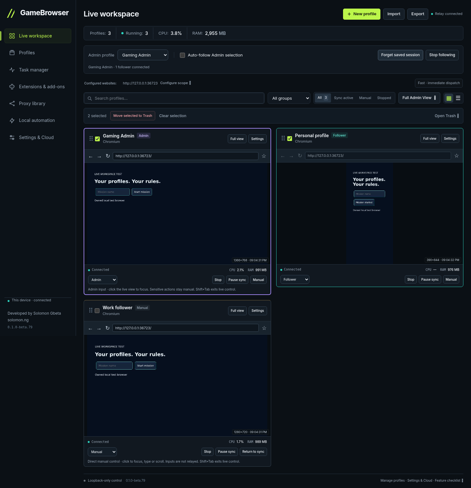

# GameBrowser Live workspace validation

These are actual source-app captures with isolated test profiles and live browser frames. They are not screenshots of private user accounts. Windows installed-app verification is a separate required release gate.

[Mobile Full Admin View](images/full-admin-mobile.png)

## Visual checks

The primary workspace and Full Admin concepts were compared with rendered desktop (1487×1058) and mobile (390×844) views using Playwright Chromium and direct image inspection. Browser/IAB tools were unavailable in this session.

| Area | Verified behavior |
|---|---|
| Palette | Slate backgrounds, lime primary actions, violet Admin and teal Follower borders match the concepts. |
| Type | Local Inter font, 24px headings, readable controls and a deliberate label hierarchy. |
| Structure | Sidebar, compact metrics, following controls, search/filter row and browser grid retain the original workspace structure. |
| Browser views | Real frames, address/tab controls, profile settings, fullscreen and return-to-grid navigation are preserved. |
| Responsive layout | Single-column mobile grid, compact expandable Full Admin controls, bottom navigation and no document horizontal overflow. |
| Portrait previews | Grid stages are bounded at 320px desktop / 240px mobile; the canvas retains its intrinsic ratio. An actual portrait click mapped exactly to native coordinates (137,331) and fired once. |
| State and focus | Fixed role colors survive selection; routine snapshots preserve keyboard focus and drafts; stale resource/sync responses do not overwrite newer state. |

State-dependent labels such as Apply selection, Forget saved session and Reconnect following describe the actual controller state. Approved-origin/pacing settings, recoverable bulk Trash, Type text, explicit manual takeover, optional bookmarks and the feature checklist remain visible functional additions to the reference designs. Actual metrics, browser content and engine names replace the concept's example data. Full Admin's generated gamepad mark and oversized heading were replaced with the primary concept's consistent brand and type scale.

## Functional source verification

- Full source regression: 2,363 passed, 11 skipped; additional focused bridge and transfer checks passed.
- Eleven independent real Chromium protocol/session checks cover exact-once mirroring, separate cookies/URLs, closed-follower waiting/reconnect, saved tabs/storage, explicit pause, Stop without browser closure and explicit Resume after app restart.
- Seven Cloud boundary checks use real browsers with a simulated service: uncached profile access, coordinator lifecycle, transient failure/reconnect, no replay, revoked grants and account isolation. These do not verify a live hosted Cloud service.
- Actual source UI checks cover setup/reopen into Live workspace, Profiles/Settings navigation, recoverable multi-profile Trash, bookmarks, resource settings and four-selected-profile Export handoff without role changes or automatic download.
- The committed Windows gate is `scripts/gamebrowser-installed-workspace-smoke.mjs`. It requires the installed UI, real bundled Firefox controls and a SHA256-pinned Chromium Admin controlling a Firefox Follower before publication.

See [the complete feature checklist](../FEATURE_CHECKLIST.md) for shipped, source-verified and external pending work. Live Cloud/remote MCP, Sites publication and the custom domain remain separate external checks.
